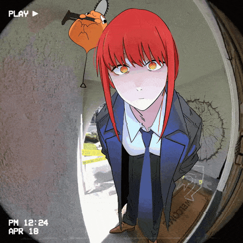
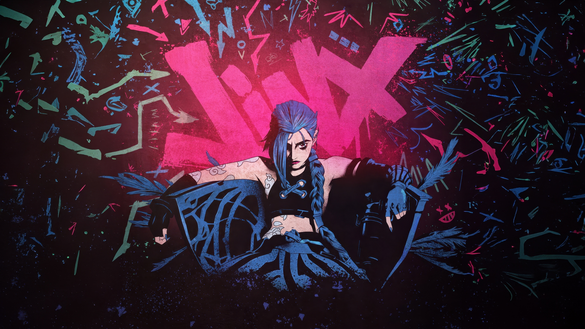
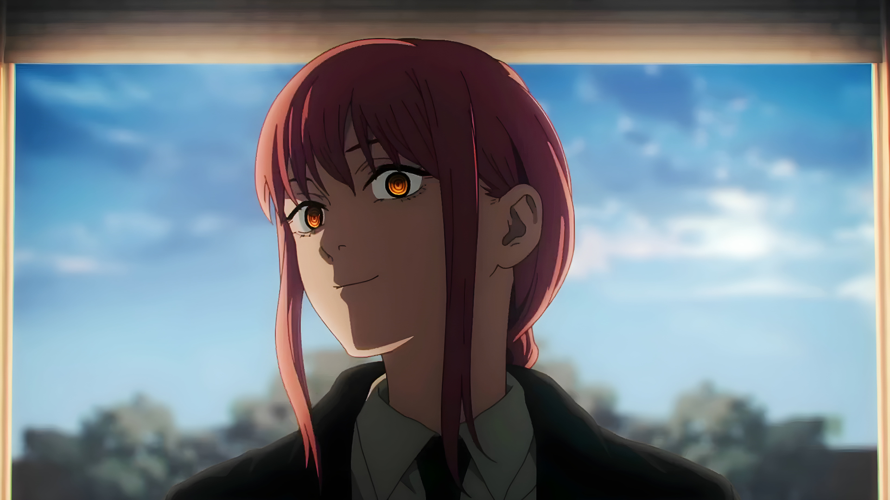

<!-- 
  ============================================================
  ✨ ANIME README TEMPLATE v4 (Projects + Fixed Sizes)
  ============================================================
-->

<!-- ============ 1. БАННЕР + АНИМИРОВАННЫЙ ЗАГОЛОВОК ============ -->
<!-- Высота 300px, чтобы баннер не съедал весь экран -->

  

   
  

<!-- ============ 2. РАЗДЕЛИТЕЛЬ ============ -->

<!-- ============ 3. БЛОК "ОБО МНЕ" ============ -->
<h2 align="center">🌸 About Me</h2>

  <table>
    <tr>
      <td width="50%">
        <h3>💫 Кто я?</h3>
        

          <i>"Вайбкод, аниме и шутки."</i>
        

        

          🔭 Работаю над <b>своими проектами</b> 
          🌱 Изучаю, что надо 
          ⚡ Fun fact: Играю в League of legends
        

      </td>
      <td width="50%" align="center">
        
      </td>
    </tr>
  </table>

<!-- ============ 4. ДИНАМИЧЕСКАЯ АНИМЕ-ЦИТАТА ============ -->

  

<!-- ============ 5. РАЗДЕЛИТЕЛЬ (Исправлена высота) ============ -->

<!-- ============ 6. TECH STACK ============ -->
<h2 align="center">🛠️ Tech Stack</h2>

<h4 align="center">Languages</h4>

  
  
  
  

<h4 align="center">Frameworks & Libraries</h4>

  
  
  

<h4 align="center">Tools</h4>

  
  
  
  
  

<!-- ============ 7. РАЗДЕЛИТЕЛЬ (Исправлена высота) ============ -->

<!-- ============ 7.5. ОБЗОР РЕПОЗИТОРИЕВ ============ -->
<h2 align="center">🚀 Featured Projects</h2>

  <table>
    <tr>
      <td align="center">
        
      </td>
      <td align="center">
        
      </td>
    </tr>
    <tr>
      <td align="center">
        
      </td>
      <td align="center">
        
      </td>
    </tr>
  </table>

<!-- ============ 8. СТАТИСТИКА GITHUB ============ -->
<h2 align="center">📊 GitHub Stats</h2>

  
  

<!-- Стрик (серия дней с коммитами) -->

  

<!-- ============ 9. GAMER VIBE (Восстановлено) ============ -->

   
  <!-- Terminal Stats (Хакерская статистика в терминале) -->
  

<!-- ============ 12. РАЗДЕЛИТЕЛЬ ============ -->
<!-- Если у тебя есть jinx_wall2.jpg, раскомментируй строчку ниже -->
<!--  -->

<!-- ============ 13. КОНТАКТЫ ============ -->
<h2 align="center">💌 Connect With Me</h2>

  
  
  

<!-- ============ 14. ФУТЕР ============ -->
 

  
  

   
  <i>✨ "The world is not beautiful, therefore it is." — Kino no Tabi ✨</i>

